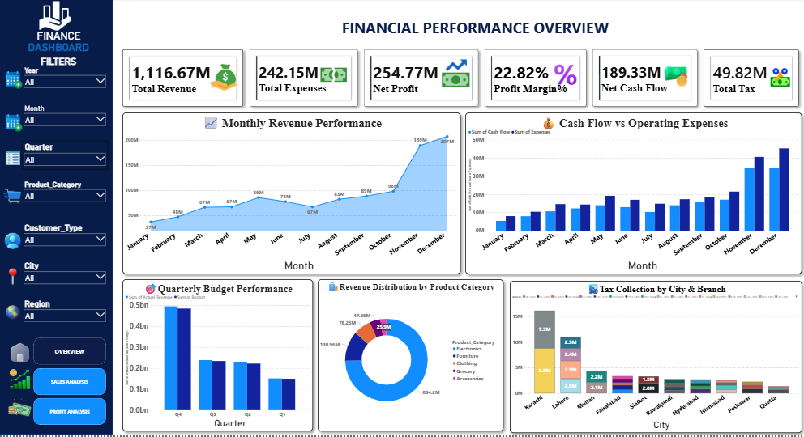
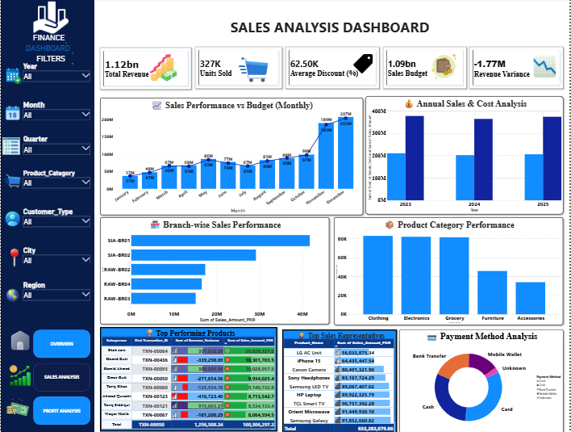
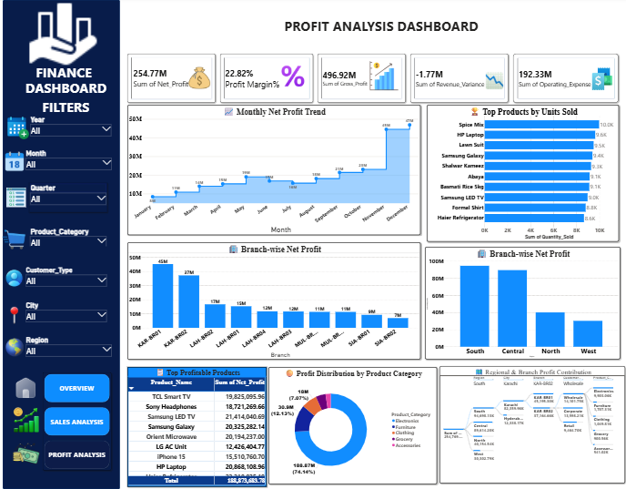
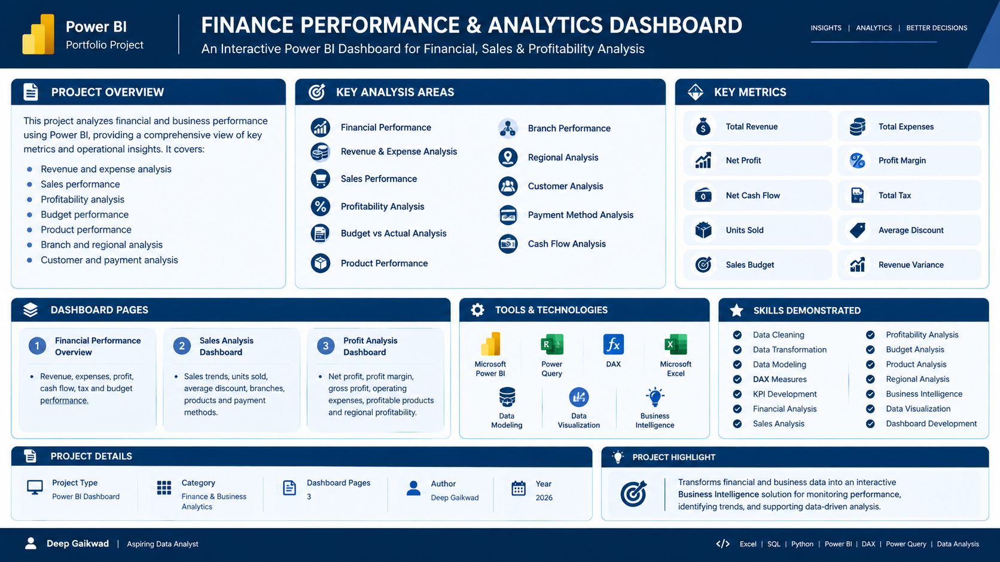

# 💰 Finance Performance & Analytics Dashboard — Power BI

An interactive **Power BI Finance Dashboard** designed to analyze financial performance, sales performance, profitability, budgeting, product performance, branch performance, regional contribution, and payment behavior.

The project transforms financial and business data into an interactive **Business Intelligence solution** using **Microsoft Power BI, Power Query, DAX, Microsoft Excel, data modeling, and data visualization techniques**.

---

## 📊 Project Overview

The **Finance Performance & Analytics Dashboard** provides a comprehensive view of business performance through three analytical dashboard pages:

### 💼 Financial Performance Overview

Provides a high-level view of financial performance, including:

- Total Revenue
- Total Expenses
- Net Profit
- Profit Margin
- Net Cash Flow
- Total Tax
- Monthly Revenue Performance
- Cash Flow vs Operating Expenses
- Quarterly Budget Performance
- Revenue Distribution by Product Category
- Tax Collection by City & Branch

### 📈 Sales Analysis Dashboard

Focuses on sales and revenue performance across different business dimensions:

- Total Revenue
- Units Sold
- Average Discount
- Sales Budget
- Revenue Variance
- Monthly Sales vs Budget
- Annual Sales & Cost Analysis
- Branch-wise Sales Performance
- Product Category Performance
- Top Performing Products
- Top Revenue Generating Products
- Payment Method Analysis

### 💹 Profit Analysis Dashboard

Analyzes business profitability through:

- Net Profit
- Profit Margin
- Gross Profit
- Operating Expenses
- Monthly Net Profit Trend
- Top Products by Units Sold
- Branch-wise Net Profit
- Regional Profit Contribution
- Top Profitable Products
- Profit Distribution by Product Category

---

## 🖼️ Dashboard Preview

### 💼 Financial Performance Overview



The Financial Performance Overview provides a consolidated view of revenue, expenses, profitability, cash flow, taxation, budgeting, product categories, and regional financial performance.

---

### 📈 Sales Analysis Dashboard



The Sales Analysis page evaluates sales performance across time, branches, product categories, products, and payment methods.

---

### 💹 Profit Analysis Dashboard



The Profit Analysis page focuses on profitability trends, profitable products, branch-level profitability, regional contribution, and product-category profit distribution.

---

## 📋 Project Information



The project information page summarizes the project's objectives, key analytical areas, metrics, dashboard pages, tools, technologies, and skills demonstrated.

---

## 🎯 Project Objectives

The main objectives of this project are to:

- Monitor overall financial performance
- Analyze revenue and expenses
- Track profitability and profit margins
- Compare sales against budgets
- Analyze revenue variance
- Monitor cash flow
- Analyze product performance
- Evaluate branch-level performance
- Analyze regional profitability
- Understand customer and payment behavior
- Identify important financial and sales trends
- Present business information through an interactive BI solution

---

## 📊 Key Performance Indicators

The dashboard includes important financial and sales KPIs such as:

| KPI | Description |
|---|---|
| 💰 Total Revenue | Overall revenue generated |
| 💸 Total Expenses | Overall business expenses |
| 📈 Net Profit | Revenue after expenses |
| 📊 Profit Margin | Profitability percentage |
| 💵 Net Cash Flow | Net cash generated |
| 🧾 Total Tax | Total tax contribution |
| 🚗 Units Sold | Total units sold |
| 🏷️ Average Discount | Average discount applied |
| 🎯 Sales Budget | Planned sales target |
| 📉 Revenue Variance | Difference between revenue measures |

---

## 💰 Financial Performance Analysis

The Financial Performance page analyzes the overall financial position of the business.

Key areas include:

- Revenue performance
- Expense performance
- Net profit
- Profit margin
- Cash flow
- Tax collection
- Monthly revenue trends
- Quarterly budget performance
- Product-category revenue
- City and branch tax collection

This provides a consolidated view of financial performance for business analysis.

---

## 📈 Sales Performance Analysis

The Sales Analysis page provides detailed insights into sales activity.

The analysis includes:

- Monthly sales performance
- Sales vs budget
- Annual sales and cost
- Branch-wise sales
- Product category performance
- Top performing products
- Top revenue-generating products
- Payment method distribution

Interactive filters allow the report to be explored across different business dimensions.

---

## 💹 Profitability Analysis

The Profit Analysis page focuses on understanding where profit is generated across the business.

The analysis includes:

- Monthly net profit trends
- Branch-wise net profit
- Regional profitability
- Top profitable products
- Product category profit distribution
- Gross profit
- Operating expenses
- Revenue variance
- Profit margin

This helps provide a structured view of profitability across products, branches, and regions.

---

## 🏢 Branch & Regional Analysis

The dashboard provides branch-level and regional analysis to understand business performance geographically.

Analysis areas include:

- Branch-wise revenue
- Branch-wise sales
- Branch-wise net profit
- Regional profit contribution
- City-level financial performance
- Tax collection by city and branch

This enables comparison of financial performance across different business locations.

---

## 📦 Product Analysis

Products are analyzed across sales and profitability dimensions.

Key analysis areas include:

- Product sales
- Units sold
- Revenue contribution
- Top revenue-generating products
- Top profitable products
- Product category performance
- Product category revenue distribution
- Product category profitability

---

## 💳 Payment Method Analysis

The Sales Analysis dashboard also includes payment-method analysis.

Payment methods can be compared to understand the distribution of transactions across different payment channels.

---

## 🎛️ Interactive Filters

The dashboard provides interactive filters for dynamic analysis.

Available filtering dimensions include:

- Year
- Month
- Quarter
- Product Category
- Customer Type
- City
- Region

Users can combine multiple filters to analyze specific segments of the business.

---

## 🛠️ Tools & Technologies

| Tool / Technology | Purpose |
|---|---|
| 🟦 Microsoft Power BI | Dashboard development and visualization |
| 🟨 Power Query | Data cleaning and transformation |
| 📐 DAX | Measures, KPIs and analytical calculations |
| 📊 Microsoft Excel | Source data and data preparation |
| 🧠 Data Modeling | Structuring financial and sales data |
| 📈 Data Visualization | Interactive business reporting |
| 💼 Business Intelligence | Financial and business performance analysis |

---

## 🧠 Skills Demonstrated

### Power BI

- Dashboard Development
- Interactive Reports
- KPI Development
- Data Visualization
- Business Intelligence
- Interactive Filtering
- Financial Reporting

### Power Query

- Data Cleaning
- Data Transformation
- Data Preparation
- Data Shaping
- Data Loading

### DAX

- Measure Creation
- KPI Calculations
- Aggregations
- Financial Calculations
- Profitability Calculations
- Sales Calculations
- Time-based Analysis

### Data Analytics

- Financial Analysis
- Sales Analysis
- Profitability Analysis
- Budget Analysis
- Product Analysis
- Branch Analysis
- Regional Analysis
- Customer Analysis
- Comparative Analysis
- Business Insights

---

## 🔄 Project Workflow

```text
Financial & Business Dataset
            ↓
      Data Cleaning
            ↓
    Data Transformation
            ↓
       Power Query
            ↓
      Data Modeling
            ↓
       DAX Measures
            ↓
   Financial & Sales Analysis
            ↓
    Data Visualization
            ↓
 Interactive Power BI Dashboard
            ↓
      Business Insights
```

---

## 📂 Project Structure

```text
Finance-Dashboard-PowerBI/
│
├── Images/
│   ├── Finance_Performance_Overview.png
│   ├── Finance_Sales_Analysis.png
│   ├── Finance_Profit_Analysis.png
│   └── Finance_Dashboard_Information.png
│
├── Finance Dashboard.pbix
├── Finance_Data.xlsx
└── README.md
```

---

## 🚀 How to Use

### Step 1 — Install Power BI Desktop

Install **Microsoft Power BI Desktop** on your system.

### Step 2 — Open the Power BI File

Open:

```text
Finance Dashboard.pbix
```

### Step 3 — Refresh the Dataset

Refresh the dataset if required to load the latest available data.

### Step 4 — Explore the Dashboard

Navigate through the three report pages:

```text
Financial Performance Overview
        ↓
Sales Analysis Dashboard
        ↓
Profit Analysis Dashboard
```

Use the available filters to explore financial and business performance from different perspectives.

---

## ❓ Business Questions

This dashboard helps answer questions such as:

- What is the overall revenue generated?
- How much are the total business expenses?
- What is the net profit?
- What is the current profit margin?
- How does revenue change over time?
- How does sales performance compare with the budget?
- Which branches contribute the most to sales?
- Which products generate higher revenue?
- Which products contribute more to profitability?
- Which product categories perform better?
- How does profitability vary by region?
- How does cash flow compare with operating expenses?
- How is tax distributed across cities and branches?
- Which payment methods are commonly used?
- What financial trends can be identified from the data?

---

## 🎓 Learning Outcomes

This project demonstrates practical experience in:

- Building professional Power BI dashboards
- Designing multi-page Business Intelligence reports
- Cleaning and transforming business datasets
- Creating DAX measures
- Developing financial KPIs
- Performing sales analysis
- Performing profitability analysis
- Performing budget analysis
- Analyzing products and categories
- Analyzing branch and regional performance
- Creating interactive filters
- Presenting financial information visually
- Converting raw business data into analytical insights

---

## ⭐ Project Highlight

The **Finance Performance & Analytics Dashboard** demonstrates how financial and business data can be transformed into an interactive Business Intelligence solution.

The project combines **financial performance, sales analysis, profitability analysis, budgeting, product performance, branch analysis, regional analysis, and transaction-related insights** into a unified Power BI reporting solution.

---

## 👨‍💻 Author

**Deep Gaikwad**

**Aspiring Data Analyst**

`Excel` | `SQL` | `Python` | `Power BI` | `DAX` | `Power Query` | `Data Analysis` | `Data Visualization`

---

## 📊 Project Category

**Data Analytics | Business Intelligence | Power BI | Financial Analytics | Sales Analytics | Profitability Analysis | Data Visualization**

---

⭐ If you find this project useful, consider giving the repository a star.